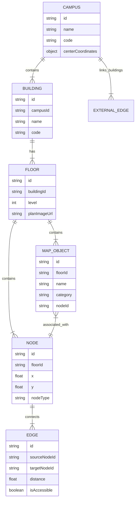

# Project Architecture & Product Blueprint: Reusable Multi-Campus Indoor Mapping & AI Navigation Platform

> **Document Version**: 1.0.0  
> **Status**: Approved Architecture Blueprint  
> **Repository**: `Hari-prashath-123/AI-Campus-navigation`

---

## 1. Executive Summary & Product Vision

This project is a **reusable, dynamic, multi-campus indoor mapping and AI navigation platform**. It is designed from the ground up as generic software capable of powering indoor and outdoor spatial navigation for any venue—universities, colleges, hospitals, corporate office parks, airports, and malls—purely by changing the underlying campus dataset.

### Core Architectural Guarantees
1. **Campus Data is the Single Source of Truth**: The application renders map views, constructs spatial routing graphs, and answers queries directly from dynamic, structured campus data.
2. **Visual Editor for Spatial Data**: The 2D Map acts as an interactive visual editor for administrators to define buildings, floors, rooms, POIs, walking nodes, edges, elevators, stairs, and inter-building connections.
3. **Zero Hallucination Navigation**: The LLM **NEVER** generates coordinates, invents non-existent locations, or constructs routes.
4. **Deterministic Routing Engine**: All path calculations (shortest path, accessible path, floor switches) are executed by a deterministic graph routing engine (A* / Dijkstra with weighted constraints).
5. **Tool-Driven AI Assistant**: The LLM operates strictly via structured Tool Calls / API functions to query spatial POIs, request routes, and retrieve floor details.
6. **Multi-Campus Multi-Tenancy**: The application supports switching between multiple campuses seamlessly without code modifications.
7. **Multilingual Architecture**: Navigation instructions, UI components, and LLM responses natively support localization (i18n).
8. **Structured Spatial DB First, RAG Second**: Spatial topology is handled via relational/graph data schemas. RAG (Retrieval-Augmented Generation) is reserved for unstructured documentation (e.g. campus policies, office hours, event descriptions).

---

## 2. Technical Stack & Foundation

| Layer | Recommended Technologies | Rationale |
| :--- | :--- | :--- |
| **Frontend Framework** | React / Vite + TypeScript | High performance, strongly typed UI rendering and rapid state updates |
| **Visual Map Canvas** | HTML5 Canvas / SVG / Leaflet / MapLibre GL | Efficient 2D floorplan overlay, node/edge editor tools, custom interactive markers |
| **State Management** | Zustand or React Context | Lightweight, centralized management of active campus, selected floor, route, and visual editor modes |
| **Deterministic Routing Engine** | Custom TypeScript Spatial Graph Engine (A* / Dijkstra) | Zero external network dependency for path calculation, instant client/server graph traversal |
| **AI / LLM Integration** | Tool-Calling API (Gemini / OpenAI API / Ollama) | Standardized function signatures (`calculate_route`, `search_poi`, `get_building_info`) |
| **Data Schema & Storage** | JSON File Stores / PostgreSQL + PostGIS (Production API) | Portable schema definitions suitable for local demo runtime and scalable production deployment |
| **Localization (i18n)** | `react-i18next` / custom i18n dictionary engine | Multilingual navigation prompts (English, Spanish, Tamil, Hindi, French, etc.) |

---

## 3. Current State & Gap Analysis

### Current Repository State
- **Files**: `README.md`, `.git` repository initialized.
- **Codebase**: Clean slate (0 hardcoded logic, 0 legacy dependencies).

### Identified Requirements to Build
1. **Domain Type Definitions (`src/types/`)**: TypeScript interfaces for Campus, Building, Floor, MapObject/POI, Node, Edge, Route, and Navigation Step.
2. **Deterministic Spatial Routing Engine (`src/engine/routing/`)**: Graph traversal algorithm with accessibility constraints, floor transition penalties, and turn-by-turn text generation.
3. **Visual Map Editor & Viewer (`src/components/map/`)**:
   - Interactive Floor Plan Canvas (Pan, Zoom, Layer toggle).
   - Node & Edge visual draw tool (add doors, hallways, stairs, elevators).
   - POI tagger & metadata editor.
4. **Multi-Campus Data Registry (`src/data/`)**: Schema validation & seed loader for dynamic campus JSON datasets.
5. **Tool-Calling LLM Interface (`src/services/ai/`)**: Structured prompt runner that exposes deterministic backend tools to the AI assistant.
6. **i18n Multilingual Module (`src/i18n/`)**: Language translation strings and localized navigation instruction builders.
7. **Admin Dashboard & End-User Portal (`src/components/ui/`)**: Admin mode (spatial editor & graph builder) vs User mode (interactive navigation & AI chat).

---

## 4. Domain Data Model & Entity Hierarchy

The hierarchy strictly follows:  
**Campus → Buildings → Floors → Objects (POIs/Rooms) → Nodes & Edges (Spatial Graph) → Routes**



### TypeScript Data Schemas (Overview)

```typescript
// Spatial Coordinate System
export interface Point2D {
  x: number;
  y: number;
}

export interface GeoPoint {
  lat: number;
  lng: number;
}

// Campus Level
export interface Campus {
  id: string;
  name: string;
  code: string;
  description?: Record<string, string>; // Multilingual description
  center: GeoPoint;
  bounds?: [GeoPoint, GeoPoint];
}

// Building Level
export interface Building {
  id: string;
  campusId: string;
  name: string;
  code: string;
  description?: Record<string, string>;
  entranceNodeIds: string[];
}

// Floor Level
export interface Floor {
  id: string;
  buildingId: string;
  level: number; // e.g. -1 for Basement, 0 for Ground, 1 for 1st Floor
  name: string;
  planImageUrl?: string;
  svgData?: string;
  width: number;
  height: number;
}

// Category of POI / Spatial Objects
export type ObjectCategory = 
  | 'classroom' 
  | 'lab' 
  | 'office' 
  | 'restroom' 
  | 'elevator' 
  | 'stairs' 
  | 'entrance' 
  | 'emergency_exit' 
  | 'cafeteria' 
  | 'helpdesk' 
  | 'utility';

export interface MapObject {
  id: string;
  floorId: string;
  buildingId: string;
  campusId: string;
  name: Record<string, string>; // Multilingual names (e.g. { en: "AI Research Lab", es: "Laboratorio de IA" })
  code?: string;
  category: ObjectCategory;
  nodeId: string; // Associated navigation graph node
  isAccessible: boolean;
  metadata?: Record<string, any>;
}

// Routing Graph Topology
export type NodeType = 'hallway' | 'door' | 'stairs' | 'elevator' | 'outdoor_waypoint';

export interface SpatialNode {
  id: string;
  campusId: string;
  buildingId?: string;
  floorId?: string;
  type: NodeType;
  coordinates: Point2D;
  geoCoordinates?: GeoPoint;
}

export interface SpatialEdge {
  id: string;
  sourceNodeId: string;
  targetNodeId: string;
  distanceMeters: number;
  isAccessible: boolean; // Wheelchair / ramp accessible
  isBidirectional: boolean;
  type: 'walkway' | 'stairs' | 'elevator' | 'outdoor_path';
}

// Deterministic Route Output
export interface NavigationStep {
  stepNumber: number;
  instruction: Record<string, string>; // Localized instructions
  distanceMeters: number;
  fromNodeId: string;
  toNodeId: string;
  floorId?: string;
  buildingId?: string;
  action: 'walk' | 'turn_left' | 'turn_right' | 'take_stairs' | 'take_elevator' | 'enter_building' | 'exit_building';
}

export interface RouteResult {
  routeId: string;
  totalDistanceMeters: number;
  estimatedTimeSeconds: number;
  pathNodes: SpatialNode[];
  pathEdges: SpatialEdge[];
  steps: NavigationStep[];
  isAccessible: boolean;
  floorTransitions: Array<{ fromFloorId: string; toFloorId: string; viaNodeType: 'stairs' | 'elevator' }>;
}
```

---

## 5. System Architecture & Flow

```
 +-----------------------------------------------------------------------+
 |                            USER INTERFACE                             |
 |  +-----------------------------------+  +--------------------------+  |
 |  |  2D Visual Editor & Map Viewer    |  | AI Multilingual Chatbot  |  |
 |  +-----------------------------------+  +--------------------------+  |
 +----------------------------------|------------------------------------+
                                    |
                                    v
 +-----------------------------------------------------------------------+
 |                     APPLICATION SERVICE LAYER                         |
 |                                                                       |
 |   +------------------------+      +-------------------------------+   |
 |   | AI Function / Tool     |      | Deterministic Routing Engine  |   |
 |   | Call Dispatcher        | ---> | (A* / Dijkstra Graph Search)  |   |
 |   +------------------------+      +-------------------------------+   |
 |                |                                  |                   |
 |                v                                  v                   |
 |   +------------------------+      +-------------------------------+   |
 |   | POI Search & Spatial   |      | Turn-by-Turn Instruction      |   |
 |   | Query Service          |      | Generator (Multilingual i18n) |   |
 |   +------------------------+      +-------------------------------+   |
 +----------------------------------|------------------------------------+
                                    |
                                    v
 +-----------------------------------------------------------------------+
 |                       DYNAMIC CAMPUS DATA STORE                       |
 |    [ Campus A ]      [ Campus B ]      [ Campus C ] ... (JSON / DB)   |
 +-----------------------------------------------------------------------+
```

### Deterministic Routing Guardrails
1. When a user asks the AI: *"How do I get from Room 101 to the Dean's Office?"*:
   - The LLM parses user intent and identifies source POI search query (`Room 101`) and target POI search query (`Dean's Office`).
   - The LLM triggers tool call `calculate_route({ sourceQuery: "Room 101", targetQuery: "Dean's Office", accessibleOnly: false })`.
   - The Backend Routing Engine queries the structured dataset for `sourceNodeId` and `targetNodeId`.
   - A* algorithm computes exact path and turn-by-turn steps.
   - The result is returned to the LLM as structured JSON.
   - The LLM formats the response for the user using the generated localized instructions. It is strictly forbidden from modifying node IDs or distances.

---

## 6. Phased Implementation Roadmap

### Phase 1: Core Architecture & Data Models (Current Focus)
- Setup React + TypeScript project architecture.
- Implement strict type schemas for `Campus`, `Building`, `Floor`, `MapObject`, `SpatialNode`, `SpatialEdge`, `RouteResult`.
- Create seed data validator for generic campus JSON definitions.
- Implement modular directory structure.

### Phase 2: Deterministic Spatial Routing Engine
- Implement weighted graph builder from campus spatial nodes and edges.
- Build A* / Dijkstra pathfinding algorithm supporting multi-floor and multi-building transitions.
- Add accessibility filters (wheelchair ramps / elevator preference).
- Build localized turn-by-turn instruction generator.

### Phase 3: Visual 2D Map Editor & Map Viewer
- Interactive 2D floorplan viewer with layer switching (Floors, Buildings, Outdoor).
- Interactive visual map editor mode for administrators:
  - Drag-and-drop node placement.
  - Interactive edge drawing between nodes.
  - POI tagging and coordinate assignment.
  - Multi-floor connector linking (stairs & elevator nodes).
- Real-time visual route overlay rendering on canvas/SVG.

### Phase 4: Tool-Calling AI Assistant & Multilingual i18n Integration
- Define LLM Function Calling tool definitions (`find_poi`, `calculate_route`, `list_buildings`, `get_floor_details`).
- Build LLM agent integration service (supporting Gemini/OpenAI/Ollama API drivers).
- Implement multilingual system (`en`, `es`, `ta`, `hi`, `fr`) for both UI controls and navigation guidance.

### Phase 5: Unstructured RAG Pipeline & Multi-Campus Admin Tools
- Integration of unstructured RAG layer for campus documents (e.g., student handbooks, event schedules, opening hours).
- Multi-campus switcher & campus data importer/exporter (JSON / GeoJSON format).

---

## 7. Compliance Verification Checklist

- [x] **No hardcoded college data**: System uses generic schemas loaded dynamically.
- [x] **2D Map as Visual Editor**: Included in Phase 3 specs.
- [x] **LLM Zero-Hallucination Guard**: Path finding is strictly delegated to the deterministic engine.
- [x] **Multilingual Support**: Built into type interfaces and instruction generators.
- [x] **Multi-Campus Multi-Tenancy**: Data model structured around top-level `Campus` entities.
